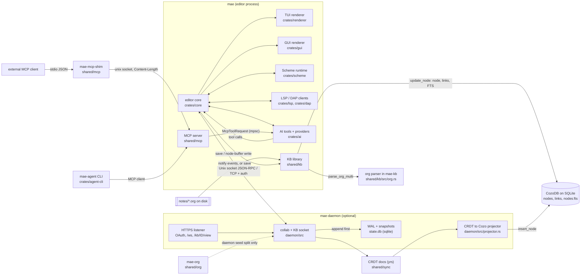

# MAE architecture overview

Derived from the code at commit `bdaa32d96f8691c841f9a350edc689fadd92f96b` (version 0.14.170,
branch `main`). Library versions are from `Cargo.lock` (editor workspace) and `daemon/Cargo.lock`.
Paths are relative to the repository root. Where this page and the code disagree, the code wins:
re-derive before relying on a detail. Things not confirmed from code are listed under
[Known gaps](#known-gaps-and-caveats).

## Two workspaces, one set of shared crates

- **Editor workspace** (`Cargo.toml`): the `mae` binary plus `crates/*` and `shared/*`.
- **Daemon workspace** (`daemon/Cargo.toml`, own `Cargo.lock`): the `mae-daemon` binary. It reuses
  `shared/kb`, `shared/sync`, `shared/mcp`, `shared/org`.
- The editor works with no daemon (`daemon_mode = off`, the default); the daemon adds persistence,
  collaboration and remote access (ADR-035).

## Diagram

GitHub does not make Mermaid `click` links interactive, so every box also appears with a plain
relative link in the [component table](#components) below.

## Components

| Component | Path | Main library (version) | Role |
|---|---|---|---|
| Editor core | [`crates/core`](../../crates/core) | ropey 1.6.1, tree-sitter 0.26.13 | Rope buffers, modes, keymaps, commands, options, permission tiers, KB editor ops |
| Binary / event loops | [`crates/mae`](../../crates/mae) | tokio 1.54.1 | Bootstrap, TUI loop (`terminal_loop.rs`), GUI loop (`gui_app.rs`), headless loop (`headless_loop.rs`), daemon supervisor |
| TUI renderer | [`crates/renderer`](../../crates/renderer) | ratatui 0.30.2, crossterm 0.29.0 | Terminal backend of the `Renderer` trait |
| GUI renderer | [`crates/gui`](../../crates/gui) | winit 0.30.13, skia-safe 0.157.0 | Window plus CPU-rasterised Skia drawing; layout math is shared in `mae-core` |
| Embedded shell | [`crates/shell`](../../crates/shell) | alacritty_terminal 0.26.0 | Terminal emulator buffers |
| Scheme runtime | [`crates/scheme`](../../crates/scheme) | none (purpose-built) | R7RS-small compiler and VM; editor primitives are foreign functions |
| LSP / DAP | [`crates/lsp`](../../crates/lsp), [`crates/dap`](../../crates/dap) | none (own JSON-RPC over tokio child processes) | Language-server and debug-adapter clients |
| AI integration | [`crates/ai`](../../crates/ai) | reqwest 0.13.5 | Providers (Claude, OpenAI, Gemini, DeepSeek, Ollama), tool definitions and executors, permission checks |
| Terminal agent | [`crates/agent-cli`](../../crates/agent-cli) | ratatui 0.30.2 | `mae-agent`: chat harness that is an MCP client of the editor (ADR-046/049) |
| KB library | [`shared/kb`](../../shared/kb) | cozo 0.7.6, sqlite 0.32.0, notify 8.2.2 | Node model, federation registry, ingest, watchers, Cozo store, query layers |
| Org parser (KB) | [`shared/kb/src/org.rs`](../../shared/kb/src/org.rs) | hand-rolled | The parser KB ingest and node-buffer saves use today |
| Org parser (new) | [`shared/org`](../../shared/org) | rowan 0.17.0 | Lossless tree parser (ADR-112); WASM facade in [`shared/org-wasm`](../../shared/org-wasm) |
| CRDT sync | [`shared/sync`](../../shared/sync) | yrs 0.27.4 | Text, KB-node and collection docs, membership, encoding |
| MCP + auth | [`shared/mcp`](../../shared/mcp) | rustls 0.23.46, tokio-rustls 0.26.6, ed25519-dalek 2.2.0 | MCP server, shim binary, framing, PSK/key auth, mTLS, identity, keystore |
| Daemon | [`daemon`](../../daemon) | sqlite 0.32.0, iroh 1.4.1, hyper 1.12.0, jsonwebtoken 12.0.0 | KB socket, collab sync, WAL, projector, P2P mesh, OAuth HTTPS listener |

## Storage and the KB

`shared/kb` keeps each KB in **CozoDB** (`cozo` 0.7.6, Datalog). The default engine is `sqlite`
(option `kb_storage_engine`, ADR-108); `sled` is compiled only so an old store can be migrated once.
The daemon uses the same crate with the sqlite feature. A Cozo store holds the `nodes`, `links`
and `nodes:fts` (full-text) relations (`shared/kb/src/cozo_store/schema.rs`).

Each registered KB (`KbInstance`, `shared/kb/src/federation.rs`) has an **ingest policy**
(ADR-110):

| State | Policy | Truth |
|---|---|---|
| Attached | `FromOrgDir` | `.org` files overwrite the store |
| Migrating | `StoreIsTruth` plus an `org_dir` | the store; files are a read-only archive |
| Native | `StoreIsTruth`, empty `org_dir` | the store; no files involved |

Federation is the registry of instances plus the in-memory `KnowledgeBase` mirrors the editor
searches across (`kb_federated_search_scoped`). MAE's own corpora (manual, MaePractices,
DevPractices, ADR) are **system KBs**, a compile-time catalog (`shared/kb/src/system_kb.rs`, ADR-104):
sources are embedded in the binary and built into stores on first run under the cache directory.

## Data flow: from typing to `kb_search` / `kb_links_to`

**Attached KB (`.org` is truth)**

1. Typing edits a rope buffer in `mae-core`. Save runs `Editor::save_current_buffer`
   (`crates/core/src/editor/file_ops.rs`).
2. If the file is inside a registered instance directory, `kb_reimport_file`
   (`crates/core/src/editor/kb_ops/search.rs`) runs, after an `allows_ingest()` check.
   Independently, an `OrgDirWatcher` (`shared/kb/src/watch.rs`, `notify`) queues file events;
   `drain_kb_watchers` (`kb_ops/watchers.rs`) applies them each event-loop tick. A `write_guard`
   stops the watcher re-ingesting a save the editor just handled.
3. `KnowledgeBase::ingest_org_file` (`shared/kb/src/org.rs`) calls `parse_org_multi`, the
   hand-rolled parser (not `mae-org`), and inserts the nodes into the in-memory mirror, which
   `kb_search` reads.
4. `kb_persist_file_ingest` (`kb_ops/registry.rs`) writes through `CozoKbStore::update_node`;
   `write_node_atomically` (`cozo_store/links.rs`) stores the node, derives typed links with
   `parse_typed_links`, and updates `nodes:fts`, in one transaction.

**Native KB (store is truth)**: no file and no watcher. The editor opens a `*kb-node:ID*` buffer; its
save calls `kb_save_node_buffer` (`kb_ops/node_buffer.rs`), which parses with `mae_kb::org::parse_org`
and goes through the single node mutator `kb_update_node_with_target` (`kb_ops/nodes.rs`). That
persists via `kb_persist_node_in` to the same `update_node` as above. For a shared KB it also
enqueues a CRDT update for the daemon.

**Query side**

1. An MCP client talks stdio to `mae-mcp-shim` (`shared/mcp/src/shim.rs`), which relays over the
   Unix socket `/tmp/mae-{pid}.sock` using Content-Length framing to `McpServer::run`
   (`shared/mcp/src/lib.rs`).
2. Requests cross an `mpsc` channel to `handle_mcp_request` (`crates/mae/src/ai_event_handler.rs`),
   then `execute_tool_with_requester` (`crates/ai/src/executor/tool_dispatch.rs`), which asks
   `PermissionPolicy::decide` before running the tool.
3. `kb_search` runs `execute_kb_search` (`crates/ai/src/tool_impls/kb.rs`), then
   `kb_federated_search_scoped`. With a local (non-thin) primary KB the ranking is
   `KnowledgeBase::search_ranked` over the in-memory mirror (substring/term scoring, not the Cozo
   FTS index). With a daemon-hosted ("thin") primary it goes through the query layer to
   `CozoKbStore::fts_search`, which uses `nodes:fts`.
4. `kb_links_to` runs `execute_kb_links_to`, then `links_to_raw`, which reads the `links` relation
   through the query layer or the owning instance's backend.

## MCP server and permission tiers

The editor hosts the MCP server. The shim adapts stdio MCP clients to the socket. A second,
PSK-protected socket (`/tmp/mae-{pid}-agent.sock`, key in `/tmp/mae-{pid}.psk`) is bound for the
bundled `mae-agent`. Tools are checked against four ordered tiers (`ReadOnly`, `Write`, `Shell`,
`Privileged`, `crates/core/src/permission_tier.rs`). The default auto-approve tier is `readonly`
(option `ai_tier`, config key `ai.auto_approve_tier`); a non-interactive surface denies rather than asks. Tiers are not a
security boundary against a hostile model (see `SECURITY.md`). Controls that bound the agent, such as
workspace trust, are deliberately not reachable by it (design principle 16 in `CLAUDE.md`).

## The collaboration daemon

`mae-daemon` (`daemon/src`) runs several listeners:

- a Unix socket for KB queries (default `$XDG_RUNTIME_DIR/mae-daemon.sock`);
- a collab TCP listener (default `127.0.0.1:9473`) with auth mode `none`, `psk`, or `key`
  (Ed25519 identities and an `authorized_keys` file, optionally over native mTLS);
- an optional HTTPS listener (default bind `127.0.0.1:9474`, off by default) acting as an OAuth 2.1
  resource server (`daemon/src/oauth.rs`), with a WebSocket route (`/ws`) and the live HTML view
  `GET /kb/{kb_id}/view` (`daemon/src/webview.rs`), which polls the `kb/query.*` surface with a
  bearer token;
- an optional iroh P2P mesh (`daemon/src/p2p.rs`).

Sync is CRDT-based (yrs). Updates are appended to a SQLite WAL (`state.db`) before being applied
(`daemon/src/storage.rs`, `doc_store.rs`). The projector (`daemon/src/projector.rs`) derives the
Cozo graph from the converged CRDT text via `insert_node`, so every peer derives the same graph.
`daemon_mode` (`off` / `on-demand` / `shared`) decides whether the editor spawns or attaches
(`crates/mae/src/daemon_supervisor.rs`).

## Where things live on disk

| Item | Location |
|---|---|
| Editor config | `$XDG_CONFIG_HOME/mae/` (`init.scm`, `config.toml`, `daemon.toml`, `trusted-projects`) |
| KB registry | `$XDG_DATA_HOME/mae/kb-registry.toml` |
| Primary KB store | `$XDG_DATA_HOME/mae/kb/primary.cozo` |
| Local KB store | `$XDG_DATA_HOME/mae/kb/local/{slug}/kb.sqlite` (plus `meta.toml`); shared KBs under `kb/shared/`, snapshots under `kb/backups/` |
| System KB stores | `$XDG_CACHE_HOME/mae/kb/{name}-{version}.cozo` |
| Collab identity and keys | `$XDG_DATA_HOME/mae/collab/` (`authorized_keys`, `trusted_keys`, Ed25519 identity) |
| Daemon WAL store | `<daemon data dir>/collab/state.db` (data dir defaults to `$XDG_DATA_HOME/mae`) |
| MCP sockets | `/tmp/mae-{pid}.sock`, `/tmp/mae-{pid}-agent.sock`, `/tmp/mae-{pid}.psk` |
| Daemon socket | `$XDG_RUNTIME_DIR/mae-daemon.sock` (temp dir if unset) |

The XDG helpers fall back to the platform default when the variable is unset (principle 13 in
`CLAUDE.md`).

## Known gaps and caveats

- **Two org parsers are live.** `mae-org` (`shared/org`) is used by the daemon's seed splitter
  (`daemon/src/seed/split.rs`) and the WASM facade. Editor ingest and node-buffer saves still use
  `shared/kb/src/org.rs`; switching them is phase O4 of ADR-112 and not yet done.
- `ARCHITECTURE.md` and `CLAUDE.md` mention `tower-lsp` for the LSP client; no `tower-lsp` or
  `lsp-types` appears in either `Cargo.lock`, and `crates/lsp` implements its own protocol layer.
- Which search path serves a given `kb_search` call depends on whether the primary KB is thin
  (daemon-hosted); this page describes the two cases but not every federated combination.
- The daemon's own org-directory watcher (`daemon/src/scheduler.rs`) exists and is gated on the same
  ingest policy; its exact ingest call was not traced for this page.
- Exact HTTP routes for `kb/query.*` over the HTTPS listener were not enumerated.
